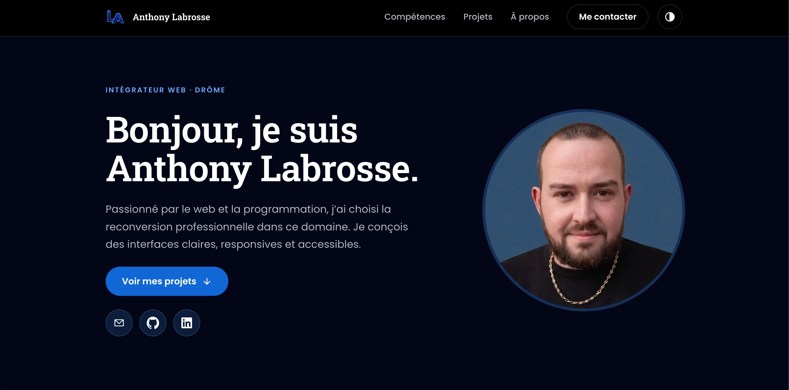

# Portfolio d'Anthony Labrosse - Intégrateur Web

🔗 **Site en ligne : [portfolio-anthony-labrosse.vercel.app](https://portfolio-anthony-labrosse.vercel.app/)**

Portfolio professionnel réalisé dans le cadre du projet 12 de la formation Intégrateur Web d'OpenClassrooms. Il présente mon parcours, mes compétences et mes réalisations.

## Fonctionnalités

- **Thème clair / sombre** géré avec React et des variables CSS.
- **Design responsive** (mobile first), avec menu adapté aux petits écrans.
- **Une page détail par projet** (`/projets/:slug`) sous forme d'étude de cas, grâce à React Router.
- **Données centralisées** : les projets sont générés à partir d'un fichier JSON (`src/data/Projects.json`).
- **Accessibilité** : lien d'évitement, navigation au clavier, focus visible, contrastes conformes WCAG AA.
- **SEO** : balises meta et Open Graph, données structurées, `robots.txt` et `sitemap.xml`.

## Technologies

- React 19, React Router 7
- Vite
- CSS natif (sans framework), variables CSS
- Déploiement sur Vercel

## Lancer le projet en local

1. Cloner le dépôt : `git clone https://github.com/Labrosse-Anthony/Projet_12-Portfolio.git`
2. Installer les dépendances : `npm install`
3. Lancer le serveur de développement : `npm run dev`
4. Ouvrir l'adresse indiquée dans le terminal (généralement `http://localhost:5173`)

Autres commandes : `npm run build` (version de production), `npm run lint` (vérification du code).

## Structure

- `src/components/` : composants (Header, Hero, Skills, Projects, About, Contact, Footer)
- `src/pages/` : pages (accueil et détail d'un projet)
- `src/data/Projects.json` : données des projets
- `src/styles/` : variables de thème et styles globaux
- `public/` : images, `robots.txt`, `sitemap.xml`
